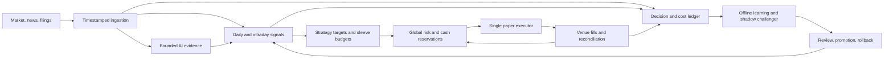

# Build a measurable paper trading laboratory

**Start with Alpaca paper trading, a small ETF/spot-crypto universe, and one always-on Python application.** Keep daily/swing and intraday strategies separate, with shared portfolio risk, one executor, continuous evidence ingestion, and an offline learning layer. Its objective should be **net profit after trading and operating costs, subject to explicit loss and capital constraints**; steady and opportunistic approaches can compete within that framework. Crypto can run continuously; ETF orders must respect supported sessions, holidays, and instrument restrictions. A practical planning envelope is **about $183/month**, or **$218 with CoinGecko Basic**, excluding unverified news licensing and taxes. Codex CLI and Grok Bot suit development and research; bounded direct APIs suit runtime text analysis. No researched product establishes a profitable edge, and paper fills cannot prove live execution quality. This blueprint reflects public documentation checked **October 24, 2026**. ASTRAL now includes a persistent local Python backend, simulator, connected paper-only Alpaca adapter, deterministic risk proposals, and dashboard; **42 local tests have passed**. Joe saved paper credentials locally, authenticated REST readback confirmed ACTIVE securities/crypto permissions and a $100,000 empty starting account, and a small IOC-limit BTC entry/exit both filled. Final reconciliation showed **zero positions, zero working orders, and $99,999.87 equity**; the $0.13 equity decrease is not fully reconciled net profit. No live trades or protective orders occurred. Autonomous strategies, complete news/learning pipelines, and hosted 24/7 operation remain future work. The remaining architecture below is proposed unless explicitly identified as implemented; the companion [risk report](Deterministic%20trading%20risk%20controls.md) records the current algorithms and their limits.

## Alpaca provides the smallest useful first integration

Alpaca supports paper ETFs and selected crypto through a common trading interface, separate paper credentials, and `https://paper-api.alpaca.markets`. Its served crypto eligibility page includes **Georgia**, but that support article dates to 2023; account approval remains necessary. Discover active, tradable assets and their precision/minimums rather than interpreting “any ETF or crypto” literally. Begin with roughly 10–20 approved liquid instruments; expand through capability-aware adapters. ([Paper trading](https://docs.alpaca.markets/us/docs/paper-trading), [Georgia availability](https://alpaca.markets/support/alpaca-cryptocurrency), [Asset discovery](https://docs.alpaca.markets/us/reference/get-v2-assets-1))

| Platform | Useful role and paper boundary | Important limits and account checks |
|---|---|---|
| **Alpaca** | First ETF/spot-crypto adapter. Paper Only receives IEX equity data. | Trading support lists **200 requests/minute/account**, from an older article. Basic historical equity data: **200/minute**, 30 streamed symbols, latest-15-minute historical restriction. **$99/month** Plus: consolidated US exchanges, unlimited equity symbols, **10,000 historical calls/minute**. These are different quota scopes. ([Trading quota](https://alpaca.markets/support/usage-limit-api-calls), [Data plans](https://docs.alpaca.markets/us/docs/about-market-data-api)) |
| **IBKR** | Later ETF/broader-market adapter; paper inherits permissions/data subscriptions and simulates top-of-book fills. | Web API: **10 requests/second/authenticated username** plus endpoint limits; history **5 concurrent**, and September 2026 pacing adds **10/second or 50/minute**. One brokerage session per username. These are not TWS limits. Resolve conflicting paper-onboarding instructions. ([Paper account](https://www.interactivebrokers.com/campus/glossary-terms/paper-trading-account/), [Web API](https://www.interactivebrokers.com/campus/ibkr-api-page/webapi-doc/), [History pacing](https://www.interactivebrokers.com/docs/web-api/changelog/2026/9/9)) |
| **Coinbase Advanced Trade** | Later crypto adapter. Its public sandbox returns **static mocked accounts/orders**, so it cannot establish market-driven fills or profitability. | Current WebSocket contract: **8 connections/second/IP**, **8 unauthenticated messages/second/IP**. Advanced Trade-specific REST quota remains unverified; do not substitute Coinbase Exchange or general App quotas. Exact fees and Georgia/account eligibility need confirmation. ([Sandbox](https://docs.cdp.coinbase.com/coinbase-app/advanced-trade-apis/sandbox), [WebSocket limits](https://docs.cdp.coinbase.com/coinbase-app/advanced-trade-apis/websocket/websocket-rate-limits.md), [Fees](https://help.coinbase.com/en/coinbase/trading-and-funding/advanced-trade/advanced-trade-fees)) |
| **Kraken Spot** | Later crypto adapter. Spot testing requires **qualified-client onboarding**; `validate=true` only checks parameters. Futures demo is a separate product. Georgia is absent from current state exclusions. | REST counter maximum/decay per second: Starter **15 / 0.33**, Intermediate **20 / 0.5**, Pro **20 / 1**. Separate per-pair trading counters and cancellation penalties apply. ([Testing](https://support.kraken.com/articles/advanced-api-faq), [REST limits](https://docs.kraken.com/exchange/guides/rest/ratelimits), [Trading limits](https://docs.kraken.com/exchange/guides/general/ratelimits), [Jurisdictions](https://support.kraken.com/articles/where-is-kraken-licensed-or-regulated)) |

Use free IEX data for plumbing and initial daily experiments. For quote-sensitive intraday evaluation, budget consolidated quotes and confirm the exact Paper Only account can obtain Plus before purchase. One central feed should fan out internally: Alpaca connection limits depend on subscription/user/endpoint, and unlimited symbols do not mean unlimited connections. Match crypto feed provenance to the execution venue. ([Streaming scope](https://docs.alpaca.markets/us/docs/streaming-market-data), [Crypto feeds](https://docs.alpaca.markets/us/docs/real-time-crypto-pricing-data))

Maintain provider/account-scoped limiters, with reserved capacity for order state, cancellation, and reconciliation. A proposed initial operating budget of 60 ordinary Alpaca trading requests/minute is an application setting, not a vendor entitlement; streams and modest order frequency should keep normal usage much lower. Observe actual headers, errors, and account limits before increasing capacity.

## Shared risk lets steady and opportunistic strategies coexist

The following architecture, thresholds, refresh schedules, and build sequence are **original engineering proposals**, not validated trading strategies or provider guarantees. Use a modular monolith: Python async tasks, SQLite for transactional state, Parquet for historical snapshots, structured events, and a small dashboard. Logical workers need not be separate paid agents.

Start with transparent hypotheses: a daily momentum ranking with a long-term trend filter and capped volatility sizing; separately, a five-minute mean-reversion hypothesis with liquidity filters, holding-time limits, and explicit exits. Freeze windows and rules before evaluating them. These demonstrate “what/when to buy” without pretending an indicator or model has established an edge. Signals produce target exposures, evidence cutoff, expiry, invalidation, and maximum execution cost. Compare against cash, fixed-weight/buy-and-hold holdings, and similar-risk benchmarks.

Daily and intraday books each need ETF/crypto attribution. Tag positions as core or opportunistic where useful, with configurable capital and loss budgets; a higher-reward experiment earns capacity through evidence rather than overriding global limits. No fixed personalized sleeve allocation is implied. Initial scope is long-only, unlevered spot/ETFs; taking measured opportunity risk does not require leverage. No-trade is a valid profit-seeking decision.

| Proposed paper configuration | Initial illustration |
|---|---|
| Aggregate gross exposure | At most 50% of paper equity |
| Instrument concentration | 10% per ETF; 5% per spot crypto |
| Economic group concentration | 25%, including overlapping ETFs and crypto ETF/direct-coin exposure |
| Planned loss per new position | 0.25% daily/swing; 0.10% intraday |
| Portfolio circuit breakers | 1% daily marked-to-market loss blocks new risk; 5% high-water drawdown pauses strategies for review |

These are test settings, not guaranteed loss caps. Size from loss budget divided by stop distance plus cost buffer, then constrain by precision, liquidity, cash, pending orders, and concentration. Stops can gap; stop-limit orders can remain unfilled. ([SEC order basics](https://www.sec.gov/files/trading101basics.pdf))

One portfolio authority atomically reserves cash/exposure, nets strategy targets against reconciled inventory and working orders, and routes only the residual. An intraday exit must not liquidate the swing book's allocation. Multiple venues need separate available-cash constraints alongside aggregate risk; cash at one exchange cannot fund an order at another. ETF/crypto overlap and stress correlation require economic exposure caps, not ticker counting.

| Order situation | Proposed execution policy |
|---|---|
| Patient, low-urgency signal | Passive limit with explicit expiry; measure fills, adverse selection, and opportunity cost |
| Time-sensitive opportunity with price bound | Marketable limit with a quote-based collar; IOC only where supported |
| IOC unavailable | Supported limit plus managed expiry/cancel; reconcile partial fills before replacing |
| Urgent risk reduction, healthy liquid market | Market or aggressive limit under preconfigured policy |
| Stale quote, halt, excessive spread, expired signal | Block new entries; reconcile and use the specified degraded-state policy |

**Limit does not mean maker.** Crossing the spread can incur taker fees. Alpaca's cited base crypto tier is 15 bps maker/25 bps taker; two taker sides imply roughly 0.5% before spread/slippage. Kraken's current base Spot table lists 0.40%/0.80%, illustrating how venue choice can overwhelm a small signal. Account/product-specific schedules govern. ([Alpaca crypto fees](https://docs.alpaca.markets/us/docs/crypto-trading), [Kraken fees](https://www.kraken.com/features/fee-schedule))

Capabilities must be checked per asset, quantity type, session, and account: Alpaca equity IOC has restrictions, fractional-equity IOC is unavailable, and extended hours require supported limit/TIF combinations. Do not assume crypto brackets or conflicting FOK descriptions work. Paper contract tests must establish actual support. ([Order matrix](https://docs.alpaca.markets/us/docs/orders-at-alpaca))

Persist intent/client ID before submitting. A timeout means unknown order state: query/reconcile before retrying, preserving the same identity. Process fills during pending cancellation; a cancel request acknowledgement is not final cancellation. Startup recovery compares open orders, fills, balances, and positions with the journal before resuming new risk.

**The service stays on 24/7; trading eligibility varies.** Run it on an always-on host with a process supervisor, independent watchdog, external heartbeat monitor, and human alerts. Keep quote/order/cancel loops independent of article retrieval, model calls, and backtests. Persist cursors/checkpoints, replay backlog with deduplication, reconnect with jitter, recover feed gaps, and handle UTC, exchange calendars, DST, weekends, maintenance, and restarts explicitly. Use distinct `HALT_NEW_RISK` and `CANCEL_AND_REDUCE` policies; stale data must not trigger indiscriminate market liquidation. A $20 infrastructure allowance buys a pilot, not proven high availability or zero downtime; standby/redundancy adds cost. Continuous observation also does not require a model call every tick.

### A living HUD makes actual state visible

The proposed dashboard uses a futuristic Jarvis/Iron Man-inspired HUD around a living, pulsing 3D universe. Keep the financial information calm and legible: account equity/current value; realized and unrealized P&L; fees, distributions, and operating expense; positions and working orders; live prices; timestamped news; risk headroom; and worker/source health. “Total money gained” should reconcile from equity minus net contributions, with operating expenses paid outside the account deducted once; deposits are not profit. Show paper mode prominently alongside the valuation currency and as-of time.

Drive the scene from server-pushed, deduplicated lifecycle events. A **confirmed buy fill** creates a nebula; a **confirmed sell fill** creates a supernova. Submitted, pending, partial, rejected, and canceled orders need distinct indicators so an animation never claims an unfilled trade happened. Worker pulses reflect actual heartbeat age; show separate browser connection, backend, market feed, and venue status. Every price/news/position panel needs source/as-of/stale badges. A simulated visual preview must be labeled demonstration data. Provide reduced motion, low-intensity effects, and a non-WebGL fallback; the scene must never block the independent risk/execution backend.

The implemented [ASTRAL application](../README.md) contains a perspective-projected 3D universe, confirmed-fill effects, account and position views, working-order controls, entry halt, and source/worker status. Its local Python backend persists intents, orders, fills, account observations, equity history, and events in SQLite; server-pushed updates drive the dashboard and reveal disconnection rather than falling back to synthetic data. The simulator remains explicitly labeled; the separate Alpaca adapter now uses user-saved local paper credentials. **42 local tests have passed**, including deterministic risk and execution behavior. Separately, a broker-paper IOC limit bought 0.000309121 BTC and its IOC limit exit sold the fee-adjusted 0.000308347 BTC; both filled. Reconciliation confirmed an empty book and $99,999.87 equity, with fees/activity still requiring full accounting. The **1440-pixel [connected desktop screenshot](../screenshots/astral-alpaca-paper-desktop.jpg)** records this paper application state. Local chaos tests and this provider lifecycle establish different evidence; neither establishes a profitable strategy or hosted 24/7 availability. News samples and illustrative charts remain preview content when no backend is connected; complete news ingestion, trained learning, autonomous strategies, and hosting remain future work. See the [risk report](Deterministic%20trading%20risk%20controls.md) for implemented algorithms and outstanding protection/data requirements.

## Current news needs measured freshness and historical availability

Feed articles, broad-market news, instrument events, filings, and macro releases into one evidence store. “Everything useful” should become a maintained source/universe coverage contract, not a promise to capture every paywall, rumor, or social post.

| Source | Useful evidence and boundary | Proposed refresh |
|---|---|---|
| Alpaca/Benzinga news | Stock/crypto history and article IDs, symbols, publication/update timestamps; **current price, quota, and entitlement unverified**. The 2022 free-beta announcement is not current pricing. ([History](https://docs.alpaca.markets/us/docs/historical-news-data), [Live schema](https://docs.alpaca.markets/us/docs/streaming-real-time-news)) | Stream if entitled; overlapping REST catch-up after gaps |
| SEC submissions/Company Facts | Filing history and standardized XBRL facts; no key. **10 requests/second/user across machines**, with identifying User-Agent. Operating-company financials apply to ETF constituents, not an ETF corporate income statement. ([APIs](https://www.sec.gov/search-filings/edgar-application-programming-interfaces), [Access policy](https://www.sec.gov/about/developer-resources)) | Scoped filing watchlist; affected facts on new filing; nightly reconciliation |
| ETF issuers | Mandate, holdings, fees, NAV, distributions, concentration; issuer-specific as-of dates/download terms. ([iShares example](https://www.ishares.com/us/products/239726/ishares-core-sp-500-etf)) | Daily after expected publication; source-change checks |
| Fed, BLS, Treasury | Policy/releases, macro calendars and revisions, daily rates; automated quotas not established here. ([Fed](https://www.federalreserve.gov/feeds/feeds.htm), [BLS](https://www.bls.gov/feed/), [Treasury](https://home.treasury.gov/treasury-daily-interest-rate-xml-feed)) | Calendar daily; fetch scheduled releases; reconcile revisions; rates daily |
| CoinGecko | Broad crypto prices/cap/volume/supply; execution prices still come from venue. Demo: **10,000 calls/month, 100/minute**. Basic: **$35/month**, 100,000/month, 300/minute; older troubleshooting conflicts. ([Pricing](https://www.coingecko.com/en/api/pricing), [Endpoint](https://docs.coingecko.com/reference/coins-markets), [Conflicting article](https://www.coingecko.com/learn/coingecko-api-troubleshooting-guide-and-solutions)) | One batched request/10 minutes: 4,320/month before overhead; configure conservatively and verify account |
| Official crypto/project/exchange notices | Protocol/security events, maintenance, listings, pair restrictions; maintain verified official allowlist. ([Ethereum](https://blog.ethereum.org/), [Coinbase](https://www.coinbase.com/blog)) | Conditional/RSS requests where supported; initially 5–15 minutes |

Normalize IDs and revisions; deduplicate syndicated stories; cluster events; map companies to ETF holdings and crypto to chain/contract/pair identity. Then perform bounded relevance/event extraction with citations. Preserve attributed facts, rumors, contradictions, and inference separately. News can supply candidate features or trigger an explicitly coded restriction; article prose cannot issue tools, access credentials, or change order authority. Treat every external document as untrusted data.

Store `event_time`, `published_at`, `updated_at`, `first_seen_at`, `available_to_bot_at`, ingestion time, as-of period, hash, parser/model version, and source/license identity. Historical replay requires `available_to_bot_at <= decision_time`; later corrections/restatements remain separate versions. A quarter-end date is not a filing availability date. Company Facts retrieved today is not a historical snapshot. ([SEC data contracts](https://www.sec.gov/search-filings/edgar-application-programming-interfaces))

Track source last-success, expected release, provider update time, receipt lag, gaps, queue age, errors, quota, missing coverage, and revisions. Quote freshness is measured in seconds; daily holdings freshness follows the issuer's cadence. Disable a news-dependent feature or use a validated price-only fallback when its source fails. Keep URLs, metadata, hashes, and permitted excerpts; retain raw full text only when storage/model-processing rights permit. **Unknown news licensing is an onboarding and budget gate**, not an included free service. Grok/X research is sampled evidence, not a firehose.

## Learning improves candidates only when the ledger stays honest

Cold start with fixed rules, conservative sizing, and no claimed calibrated win probabilities. Model confidence in an extraction/classification is different from probability of positive return. Nightly attribution separates signal, sizing, execution, fees, and operating expense; retain holds, rejected proposals, expired/unfilled orders, and unfinished outcomes. Add future market marks at predefined horizons only when labels mature. An unfilled proposal has no observed counterfactual fill or realized trade P&L.

Weekly, propose a small registered set of thresholds, lookbacks, ranking weights, or execution waits. Use chronological walk-forward evaluation, purge overlapping labels around splits, preserve a suitable embargo and untouched holdout, and log **every trial**. Repeated search inflates apparent performance; one best backtest is insufficient. ([Original backtest-overfitting research](https://www.davidhbailey.com/dhbpapers/backtest-prob.pdf))

Compare champion/challenger on the same snapshots, risk budget, benchmark, and fill assumptions; shadow targets avoid doubling portfolio exposure. Run price-only versus news-enabled ablations and source-family removals. Evaluate net returns, drawdown/tails, turnover, cost stress, calibration, regime/parameter stability, and uncertainty. Human process-quality annotations must retain author/time and whether they preceded outcomes. Promotion records include dataset/code/model versions, candidate differences, evidence, review, activation, and rollback. The learner cannot raise hard risk limits, capital authority, or live permissions. Weak evidence means retain the champion. No universal days/trade-count threshold proves profitability.

| Telemetry family | Minimum reconstructable evidence |
|---|---|
| Identity and data | Run/trace/experiment IDs; strategy, code/config/model/prompt versions; snapshot hashes; venue/account/paper mode; source timestamps, quote age/spread, gaps and symbol mapping |
| Decisions and risk | Candidate set, feature values, targets, holds/vetoes/reasons, evidence, expiry; global/strategy/venue cash, reservations, exposure/overlap, volatility, P&L, drawdown and limit headroom |
| Orders and execution | Intent/client/venue IDs; type/TIF/quantity/prices; complete partial-fill/cancel/reject/unknown lifecycle; fees/currency/maker status; latency, slippage, fill ratio, mismatches and duplicate prevention |
| Workers and reliability | Job/request/attempt IDs; token/cache buckets, reasoning subset, tool/X-item counts; retries including SDK retries, deadlines, 429s, queue age, limiter scope, CPU/storage, estimated and actual USD |
| Learning and source health | Training/validation cutoffs, trials, mature labels, benchmark, drift/calibration, promotion/rollback; license/cursor/revision, availability lag, missing coverage, unique/duplicate items and dollars per usable event |

Use append-only events plus transactional ledgers and backups first; OpenTelemetry traces/metrics/logs can connect loops. Allocate shared host/feed bills once, expose total and per-job/strategy/trade costs, and report `N/A` per trade when none occurred. Unknown cost is not zero. OpenAI reasoning is a subset of billed output; xAI actual billed ticks include server-tool charges, so do not add them again. ([OpenTelemetry](https://opentelemetry.io/docs/concepts/signals/), [OpenAI reasoning billing](https://developers.openai.com/api/docs/guides/reasoning), [xAI actual cost](https://docs.x.ai/developers/cost-tracking))

## A bounded budget supports continuous operation and staged proof

Use Jev for typed relevance/event judgments, direct model APIs for constrained analysis, and deterministic code for prices, arithmetic, risk, and side effects. Codex CLI supports JSONL/schema outputs for development and replay tasks. Official Grok Bot is a separate persistent subscription product; neither its subscription nor Codex subscription has a known fixed per-worker API dollar price. ([Jev](https://docs.typesafe.ai/introduction), [Codex automation](https://learn.chatgpt.com/docs/non-interactive-mode), [Codex authentication](https://learn.chatgpt.com/docs/auth), [Grok Bot](https://docs.x.ai/grok-bot/overview))

The following derived estimates assume **one whole-universe job**, 8,000 uncached input tokens and 1,500 total billed output tokens including reasoning; no retries/tools/cache charges. Jev performs a narrower typed job with 8,000 input and free output. Monthly constants: 22 ETF sessions, 30 crypto days; 78 five-minute runs/ETF session and 288/crypto day. `job_cost = (input × input_rate + total_output × output_rate) / 1,000,000`.

| Model; USD input/output per million | Per job | ETF daily: 22 | Crypto daily: 30 | ETF 5m: 1,716 | Crypto 5m: 8,640 |
|---|---:|---:|---:|---:|---:|
| Jev 1.14; $0.042/free | $0.000336 | $0.0074 | $0.0101 | $0.58 | $2.90 |
| GPT-6 Luna; $0.10/$0.50 | $0.00155 | $0.0341 | $0.0465 | $2.66 | $13.39 |
| GPT-6.1 Sol; $2/$10 | $0.031 | $0.682 | $0.93 | $53.20 | $267.84 |
| Grok 4.7, <200k context; $2/$6 | $0.025 | $0.55 | $0.75 | $42.90 | $216 |

Rates are checked public API prices, not measured invoices or equivalent-quality claims. ([TypeSafe pricing](https://docs.typesafe.ai/models), [OpenAI pricing](https://developers.openai.com/api/docs/pricing), [xAI pricing](https://docs.x.ai/developers/pricing))

| Monthly role/budget | Explicit workload | USD |
|---|---|---:|
| Data, signals, risk, execution, numerical learning | Shared host; no model tokens | Included below |
| Jev text features | 10,356 bounded jobs | $3.48 |
| Luna proposals | 10,356 bounded jobs | $16.05 |
| Sol daily/swing oversight | 52 bounded jobs | $1.61 |
| Sol learning retrospective | 8 jobs, each 20k input/5k output | $0.72 |
| Grok sampled research | 60 bounded jobs; 120 web calls; 600 fetched X posts | $5.10 |
| **Runtime AI** | Above assumptions | **$26.96** |
| Consolidated equity data | Alpaca Plus, entitlement pending | $99.00 |
| Host/storage/backups | $15 + $5 planning allowances, not vendor quotes | $20.00 |
| Optional Codex API development | 20 jobs at 100k input/20k output, GPT-5.3-Codex $1.75/$14 per million | $9.10 |
| Incremental news inference | 30k × 1k-token Jev items; summarize 3k × 2k-input/500-output Luna items | $2.61 |
| Contingency | Reserve, not a bill | $25.00 |
| **Conditional planning envelope** | Excludes unknown news licensing/taxes | **$182.67** |
| Optional CoinGecko Basic | Adds $35/month | **$217.67 total** |

News volumes/context caps above are illustrative, not coverage or quality promises. Add inference once if not already in snapshot tokens. xAI web search is $5/1,000 calls; X search bills $5/1,000 fetched posts and $10/1,000 profiles, including fetched parent/quoted items. Actual costs include all requests, attempts, caches, tools, failures, and unfinished jobs. ([xAI tool prices](https://docs.x.ai/developers/pricing))

At a strict $100 ceiling, a $99 feed leaves no practical room for paid operation: use free data for early plumbing/daily research and defer consolidated intraday claims. Under $300, unknown news licensing still needs an explicit quote and remaining budget. Do not spend simply because allowance exists; unchanged text need not be reclassified every five minutes.

Model limits are also shared: Jev org RPS/TPS require its console; default request/question caps are 64k/32k tokens. OpenAI's published Build-tier examples list 5,000 RPM and 1M Sol/2M Luna TPM; xAI Grok 4.7 Tier 0 lists 150 RPS/50M TPM. Actual account/model limits govern, not worker count. Set much lower application concurrency, deadlines, token/tool/attempt caps, and daily/monthly dollar limits. Budget exhaustion stops optional AI while reconciliation and risk handling continue. ([Jev limits](https://docs.typesafe.ai/models), [OpenAI limits](https://developers.openai.com/api/docs/guides/rate-limits), [xAI limits](https://docs.x.ai/developers/rate-limits))

For the paper bootstrap, create a Paper Only account, select realistic virtual capital, and generate its separate paper keys. Keep secrets outside the repository, disable live mode, and reject unexpected execution hosts rather than silently falling back. Confirm data entitlements, discover assets read-only, connect streams, record without orders, then run the controlled lifecycle test. Preserve experiment history instead of resetting away losses. This is the implementation sequence, not an action already performed. ([Paper setup](https://docs.alpaca.markets/us/docs/paper-trading))

| Build stage | Concrete deliverable and proof |
|---|---|
| **1. Paper foundation** | Paper-only configuration, comparable-to-intended-capital notional, asset registry, schema/ledger, provider limiters, read-only data/order capture, dashboard and spend meters. Record a session before orders. |
| **2. Recoverable execution** | Controlled paper submit/fill/cancel lifecycle; restart reconciliation; tests for accepted-but-timed-out submit, duplicates, partial-fill/cancel races, stale streams, 429s, rejects and cash constraints. |
| **3. Strategies and 24/7 operations** | One frozen daily baseline, then intraday; shared reservations, horizon books, core/opportunity tags, watchdog/alerts, calendar boundaries and maintenance recovery. |
| **4. Evidence and learning** | Licensed incremental news/filings, timestamped features, nightly attribution, weekly bounded candidates, walk-forward/holdout artifacts and shadow challengers. |
| **5. Economic evaluation** | Frozen forward-paper run against benchmarks and pessimistic cost assumptions; review drawdown, uncertainty, reliability, source value and total operating cost before expanding venues. |

Operational proof and economic proof are separate. A system can recover every order correctly and still lose money. Alpaca paper omits market impact, queue priority, latency slippage, regulatory fees, and dividends, and does not constrain fills to displayed quote size; retain a separate conservative cost/total-return model. Paper results establish neither live liquidity nor live profitability. ([Paper assumptions](https://docs.alpaca.markets/us/v1.4.2/docs/paper-trading))

## The first milestone is a system that can explain its decisions

The immediate code slice is a paper-only service that discovers instruments, records current evidence, produces one strategy target, applies shared risk, executes/reconciles one controlled paper lifecycle, and reports every dollar of operating expense. This creates the foundation for testing whether news, models, opportunistic risk, or learning add value rather than merely activity.

Profit remains the objective; capital preservation and no-trade decisions are part of pursuing it. No model name or uptime target establishes an edge. Live activation and any live learning about impact/fees require a separate later decision supported by the paper evidence, actual account entitlements, and measured operating reliability.
