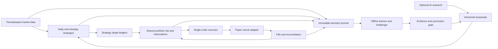

# Paper-first trading bot: strategy, risk, execution, and bounded learning

## What should the trading system and its AI workers actually do?

### Takeaway
Proposed engineering design for this user: one Python application, two separate strategy ledgers (daily/swing and intraday), shared portfolio risk, one order executor, and a bounded offline learning loop. Start with one paper venue and a small approved instrument universe; add venues through adapters after order reconciliation works. The user's current constraints are Georgia, U.S.; $100–$300/month all-in paper budget; ETFs and spot crypto; both holding periods; a learning layer; and a knowledgeable human market participant.

### Cited Findings
- The CFTC cautions that AI cannot predict sudden market changes and warns against bots promising guaranteed or unusually high returns. This does not say all quantitative modeling is useless; it does mean that an AI product name is not evidence of a profitable trading edge. — [CFTC AI trading bot advisory](https://www.cftc.gov/LearnAndProtect/AdvisoriesAndArticles/AITradingBots.html)
- The SEC/FINRA/NASAA investor article says AI-generated investment information can be inaccurate, incomplete, outdated, misleading, or fabricated, including when inputs are accurate. — [Joint investor article](https://syndication.finra.org/content/artificial-intelligence-ai-and-investment-fraud)
- Alpaca provides client order identifiers and recommends streaming updates to maintain order state. — [Alpaca orders](https://docs.alpaca.markets/us/docs/orders-at-alpaca)

### Inferences
- Treat Jev/Codex/Grok proposals as untrusted research inputs. A coding agent can build software, inspect evidence, explain anomalies, and propose experiments; these capabilities do not establish its ability to make profitable trades. No specific trading edge for these products was established in this research.
- Define responsibilities clearly: (1) data/universe worker, (2) numeric daily strategy, (3) numeric intraday strategy, (4) deterministic portfolio/risk authority, (5) single executor/reconciler, (6) recorder and scheduled offline learner, (7) optional AI research/report worker. These are modules or loops, not seven always-running paid AI agents.
- AI research can extract sourced, timestamped facts and propose candidate ranks or hypotheses. Numeric signals turn completed, available-at-time data into target exposures. Risk is code with immutable hard limits. The executor alone possesses trading credentials and accepts only validated order intents. `HOLD`/`NO_TRADE` must be normal successful outputs.
- Use a modular monolith initially. Suggested boundaries: `data`, `instruments`, `strategies/daily`, `strategies/intraday`, `portfolio`, `risk`, `execution`, `brokers`, `learning`, `telemetry`. Backtest, replay, and paper should call the same strategy/risk functions with different clocks and execution adapters.
- One event journal and a small SQLite database can track intents, orders, fills, balances, reservations, strategy ledgers, learning runs, and configuration versions; store historical bars/quotes in Parquet. Do not introduce a message bus, Kubernetes, or an agent swarm for this initial budget.
- Market-data handling, cancellation/reconciliation, and signal evaluation need independent queues or tasks; an LLM call, historical download, or long backtest must not block order updates or cancels. Reserve request capacity for order status and risk-reducing actions; suspend new entries as capacity falls.
- Paper and live are separate explicit modes, credentials, endpoints, stores, and dashboards. Ship with live mode disabled and no live credentials loaded. No worker needs withdrawal permission. A separate later action is required to enable and fund live trading.
- Conceptual flow:

### Gaps
- Exact paper notional, desired market hours, tolerated drawdown, minimum strategy holding periods, and intended eventual live capital still need selection. The architecture does not depend on choosing these immediately.
- Venue pricing, Georgia eligibility, account-specific limits, data licenses, and worker/API prices belong in the parallel provider/cost research. No accounts were opened and no API action was performed here.

## How can the bot choose instruments and buy/sell times without scanning everything with an LLM?

### Takeaway
Separate discovery, eligibility, ranking, and execution. Begin with two frozen, transparent baseline strategies that demonstrate the complete workflow; measure whether either adds value after costs rather than assuming a familiar indicator is an edge.

### Cited Findings
- Coinbase's product metadata exposes trade increments, minimum sizes, trading-disabled/cancel-only/limit-only status, and product type. These fields demonstrate why a ticker alone is insufficient to decide that an instrument can be traded. — [Coinbase Get Product](https://docs.cdp.coinbase.com/api-reference/advanced-trade-api/rest-api/products/get-product)
- ETF prices can differ from net asset value; bid/ask spreads reduce returns; fund sites publish holdings, spreads, and premium/discount history. — [SEC ETF bulletin](https://www.investor.gov/introduction-investing/general-resources/news-alerts/alerts-bulletins/investor-bulletins-24)
- Backtests can contain survivorship and look-ahead bias when current constituents or information unavailable at the decision time are used. QuantConnect recommends point-in-time data and walk-forward testing. — [QuantConnect research guide](https://www.quantconnect.com/docs/v2/writing-algorithms/key-concepts/research-guide)

### Inferences
- “Any ETF or crypto” should mean extensible asset adapters and discovery, not unrestricted authority to trade every listing. Maintain an approved registry that intersects venue availability, account eligibility, asset class, instrument status, supported order types, data coverage, minimum size, precision, spread, volume, and exposure classifications. Exclude leverage, inverse products, derivatives, shorting, and new/illiquid coins in the first experiment.
- Start with approximately 10–20 liquid approved instruments as an engineering scope choice, not a security recommendation. Use numeric filters across that list. Revalidate status and precision before submitting orders. Cache metadata and refresh on schedule/change; do not ask an LLM to repeatedly inspect every tick or every symbol.
- Proposed daily baseline: evaluate completed daily bars, rank a fixed allowlist by a fixed trailing-return measure, require a long-term trend filter, select a fixed maximum number, and allocate using a capped volatility rule. An illustrative hypothesis is 90-day momentum with a 200-day moving-average eligibility filter, evaluated once daily and rebalanced weekly. Exact windows are unvalidated parameters to freeze before testing, not a recommended profitable recipe. Execute only after the signal's input bar is available; do not pretend to trade at that same historic close.
- Proposed intraday baseline: a separate long-only, 5-minute ETF or spot-crypto mean-reversion hypothesis using deviation below a rolling mean or session VWAP, a liquidity/volatility filter, a fixed time limit on holdings, and an explicit exit rule. For ETFs choose a regular-session window and a scheduled end-of-day flatten attempt; for crypto choose an explicit UTC session/window so “intraday” has a clear meaning. Begin with a small instrument subset and no overnight carry for this strategy. Compare a simple breakout hypothesis only as a separately recorded experiment, not repeated ad hoc optimization.
- Both strategies output structured target weights/quantities, data cutoff, reason codes, entry expiry, invalidation/exit condition, and maximum tolerated execution cost. The paper profile determines the size. Entry, exit, risk reduction, and opportunity expiry are separate decisions; a lower rank does not automatically justify an urgent market sale.
- Compare each baseline with cash/no-action, buy-and-hold or fixed-weight holdings on the same eligible universe, and a baseline scaled to similar volatility/exposure. Compare net returns, drawdown, turnover, costs, and uncertainty; a lower-risk strategy should not be judged only on raw return.
- Track exposure at the economic level: several equity ETFs may overlap; a crypto ETF and direct holdings of that crypto can duplicate exposure; multiple coins can become correlated in stress. Add fixed group caps and rolling correlation reports. Correlation estimates supplement caps and stress scenarios; they cannot guarantee diversification.

### Gaps
- These are implementation baselines with no verified predictive edge, not instrument recommendations. Data procurement, historical universe reconstruction, and the user's preferred thesis will determine which hypotheses are worth testing.
- A small static current allowlist is useful for plumbing, but any historical performance result must disclose its selection bias unless reconstructed point-in-time membership is available.

## How should the two strategies and several venues share capital and risk?

### Takeaway
Use one portfolio authority even if multiple strategies or broker accounts are present. Strategy P&L must be separate, while cash, pending orders, and total economic exposure are controlled together.

### Cited Findings
- Pending opening orders reduce Alpaca buying power before they fill. Order states include partial fills and pending cancellation/replacement. — [Alpaca orders](https://docs.alpaca.markets/us/docs/orders-at-alpaca)
- Standard settlement for applicable U.S. ETF transactions is T+1, effective May 28, 2024. — [SEC T+1 bulletin](https://www.investor.gov/introduction-investing/general-resources/news-alerts/alerts-bulletins/investor-bulletins/new-t1-settlement-cycle-what-investors-need-know-investor-bulletin)
- Stops are triggers rather than guaranteed execution prices; stop-limit orders may not fill after price moves away. — [SEC trading basics](https://www.sec.gov/files/trading101basics.pdf)

### Inferences
- Keep a virtual ledger per strategy: allocated capital, desired holdings, attributed fills/fees, realized/unrealized P&L, and reserved exposure. The daily strategy's holding must not be sold merely because the intraday strategy exits its own allocation. Use an explicit deterministic fill-allocation rule.
- Compute the approved aggregate target, subtract reconciled actual inventory and signed remaining working orders, and route only the residual. Reserve cash and exposure atomically before dispatch; release reservations only when lifecycle evidence permits it. Protective/conditional orders need group-aware accounting to avoid double counting exits, while still considering possible race outcomes.
- Avoid conflicting venue orders for the same economic exposure. Do not buy direct crypto in one account while treating a crypto ETF in another account as unrelated capacity. Venue balances are separate constraints; central risk totals them conservatively. Cross-venue transfers or rebalancing are out of scope initially.
- Start both strategies on the same paper venue with a fixed capital split. If separate paper accounts improve experimental attribution, keep one shared risk dashboard and still budget the combined exposure. Add a second venue only after restart and reconciliation tests pass.
- Illustrative paper-only profile for testing, not personalized portfolio advice: no leverage/shorting; maximum 50% aggregate gross exposure; 10% per ETF and 5% per spot crypto; 25% per economic group; 0.25% of paper equity planned loss per new daily position, 0.10% intraday; 1% daily marked-to-market loss blocks new risk; 5% high-water drawdown pauses strategies for review. All are proposed configuration values, not provider rules or guaranteed loss limits.
- For stop-based sizing, a starting calculation is `quantity = floor_to_increment(risk_budget / (abs(entry - stop) + per_unit_cost_buffer))`, then take the minimum imposed by notional, liquidity, available cash, portfolio/group limits, and pending-order reservations. If stop distance is zero/invalid or order size falls below the minimum, do not trade. Gaps, fees, incomplete fills, outages, and stop-limit nonexecution can exceed the planned loss.
- Track cash/settled cash, gross and group exposure, realized and unrealized P&L, high-water drawdown, rolling volatility, correlated concentration, turnover, fees, spread/slippage cost, and downside stress loss. Define the daily risk boundary explicitly: one UTC portfolio boundary plus ETF session reporting, rather than silently mixing calendar days and trading sessions.
- Hard entry blocks: stale or missing required data; duplicate intent; unreconciled positions; invalid instrument status/size; market not in an allowed session; excessive spread; price outside collar; insufficient reserved cash; strategy or portfolio loss trigger; too many rejects; unhealthy order stream; exhausted request headroom. Exits and cancels get a separately specified policy.
- Provide two distinct controls: `HALT_NEW_RISK` and a preconfigured `CANCEL_AND_REDUCE` policy. A kill switch is not a promise to flatten instantly. Automatically sending unlimited market orders during stale data or a venue outage can add damage. Preserve broker-native protection when supported; require confirmed state before replacing/canceling it.
- Keep corporate actions and the broker account model explicit: ETF distributions, splits, symbol changes, session calendars, and settled-funds constraints affect ledgers and signals. Crypto needs 24/7 health coverage, fees in the received asset where applicable, custody awareness, and explicit maintenance/outage behavior.

### Gaps
- These paper values require tuning to intended live capital and risk tolerance before live deployment. There is no universally correct per-position percentage or drawdown pause threshold.
- Margin/cash account rules and day-trading eligibility must be checked for the selected live broker/account at that time; paper eligibility is not live approval.

## When should the executor use passive limit, marketable limit, market, or stop orders?

### Takeaway
Make this an execution policy with measured costs and deadlines, rather than an LLM improvisation. Limits control worst acceptable prices, while market orders prioritize execution; neither solves unavailable liquidity or closed/failed venues.

### Cited Findings
- Market orders generally execute immediately at available prices but do not guarantee price. Limit orders specify a price or better but do not guarantee execution. Stops become market orders after triggering; a stop-limit preserves a limit and can remain unfilled. — [SEC trading basics](https://www.sec.gov/files/trading101basics.pdf)
- At Alpaca, IOC can fill part and cancel the remainder; equity IOC entries are marked with a sales-contact asterisk, fractional-equity IOC is not supported, and crypto has GTC market/limit/stop-limit plus IOC market/limit in the order matrix. Bracket legs can both fill during fast conditions. — [Alpaca order matrix and bracket caveat](https://docs.alpaca.markets/us/docs/orders-at-alpaca)
- Alpaca crypto market and marketable-limit orders remove liquidity. Its published lowest fee tier is 15 basis points maker and 25 basis points taker per trade; fee denomination depends on the credited asset. — [Alpaca crypto fees](https://docs.alpaca.markets/us/docs/crypto-trading)

### Inferences
- Proposed decision table:

| Situation | Proposed policy | What must be measured |
|---|---|---|
| Low urgency, small order, patient signal | Passive limit with an expiry | Fill probability, adverse selection, opportunity cost, maker fees |
| Time-sensitive entry/exit with a price bound | Marketable limit, IOC if actually supported | Spread, depth, collar, fill fraction, taker fees |
| IOC unavailable | Supported limit plus managed expiry/cancel | Fill/cancel race, partial fills, residual quantity |
| Urgent risk reduction in a healthy liquid market | Market or aggressively priced limit according to preconfigured policy | Price risk versus nonexecution risk |
| Stale quote, wide spread, halt, unsupported combination, expired signal | No new trade; reconcile and alert | Reason code and health state |

- A marketable buy limit crosses the ask but caps the highest acceptable price; a marketable sell limit crosses the bid but caps the lowest. It can still partially fill or not fill. A marketable limit is not automatically a maker order or cheap execution.
- Estimate acceptable execution cost against the signal horizon and expected advantage. Include spread, maker/taker fees, observed delay/slippage, and chance of missing the trade. Do not “chase until filled” after an expired opportunity. A threshold that rejects every trade is a valid result to investigate.
- Use quote time and quote source, not the last trade or daily close, to establish a current price collar. Bound size relative to observed market depth/volume as available. Never infer infinite fillable liquidity from a paper simulator.
- Broker stops are useful but are not guaranteed loss caps. A crypto stop-limit that cannot execute after a gap is a materially different protection from a stop-market. An application watchdog depends on your process, feed, and API staying available. Do not call locally emulated brackets equivalent to broker-native brackets.
- Maintain a persistent state machine: intent created → risk reservation → submitting → acknowledged/unknown → partially filled → filled/canceled/expired/rejected. Treat timeout as unknown outcome, not failure. Query using the same client order ID before retrying; generating a new ID after a timeout can duplicate the trade.
- Cancel acknowledgement is not final cancellation. Process fills arriving during pending cancellation, reconcile remaining quantity, and only then choose a replacement. After reconnect/restart, fetch open orders, recent fills, positions, and balances; compare with the journal before resuming risk. Deduplicate events by broker fill/order identity.
- Test native protection capabilities per venue, asset class, quantity type, and session rather than assuming that a generic `bracket` field works on crypto. For a partial entry, protection must cover actual filled quantity under the chosen native/application policy; do not silently wait for full fill while assuming the position is protected.

### Gaps
- Important documentation conflict: [Alpaca July 2025 support page](https://alpaca.markets/support/what-type-of-orders-are-supported-for-cryptocurrency) lists crypto FOK, but [October 2025 support](https://alpaca.markets/support/what-is-the-status-of-cryptocurrency-trading-on-alpaca), the [crypto docs](https://docs.alpaca.markets/us/docs/crypto-orders), and the current order matrix list GTC/IOC. Use the current matrix conservatively and verify account-specific support with paper contract tests before relying on it.
- Explicit first-party evidence saying crypto brackets are unsupported was found in a [2022 Alpaca staff forum response](https://forum.alpaca.markets/t/is-it-possible-to-make-a-bracket-order-for-crypto/8085); this is old. Current crypto docs enumerate simple order types but do not provide a clear current bracket capability matrix. Phrase as “do not assume support; verify” rather than treating that old response as live confirmation.
- The Coinbase product doc's generated example mixes spot/futures-looking fields and placeholder prices. Use field definitions, not example values, as instrument specifications. Its prose for `post_only` appears odd (“posted, not cancelled”); do not use that prose as a trading rule without endpoint-specific verification.

## What does paper trading prove, and what should the acceptance gates be?

### Takeaway
Paper trading is an integration and forward-observation stage, not proof of live execution quality or profitability. Gate operational correctness separately from strategy evidence, and retain failures instead of resetting them away.

### Cited Findings
- Alpaca paper uses simulated fills, separate keys/endpoints, and offers crypto simulation. Paper-only accounts receive IEX data. Its specification excludes market impact, latency slippage, queue position, regulatory fees, and dividends; it also says order size is not checked against actual displayed liquidity. — [Alpaca paper docs](https://docs.alpaca.markets/us/docs/paper-trading); [accessible versioned specification](https://docs.alpaca.markets/us/v1.4.2/docs/paper-trading)
- QuantConnect documents realistic fill modeling using bid/ask and slippage rather than treating every fill as the last price. — [QuantConnect equity fill model](https://www.quantconnect.com/docs/v2/writing-algorithms/reality-modeling/trade-fills/supported-models/equity-model)
- Bailey et al. explain that trying many strategy configurations can produce backtest overfitting and that standard holdout methods alone can be unreliable in investment backtests. — [Original probability of backtest overfitting paper](https://www.davidhbailey.com/dhbpapers/backtest-prob.pdf)

### Inferences
- Concrete bootstrap: choose paper notional comparable to intended live size; create the selected paper account and paper-only keys; discover instruments read-only; connect data and order streams; record a session without orders; submit one controlled paper lifecycle test; reconcile; then enable one baseline, then the second under shared risk. Do not reset balances/history to erase losses. Archive experiment IDs and configuration before a deliberate fresh experiment.
- Backtesting requirements: point-in-time instruments and features; availability timestamps and revisions; correct calendars/timezones; raw versus adjusted price handling; dividends/splits; bid/ask or conservative spread approximation; fees; realistic delays, slippage and size limits; no trading at a close used to create the signal; no future news/holdings; separate training, validation, final holdout periods.
- Walk forward in chronological order. Record every parameter trial and compare adjacent parameter values, different regimes, and more pessimistic costs. Freeze a candidate before forward paper observation. Backtest only the strategy and operating rules you can actually execute on the intended venue.
- Operational acceptance examples: zero unexplained duplicate orders; zero unexplained ledger-position differences; all fills/rejects/cancels attributed; stale-data and loss-limit blocks actually prevent new risk; restart recovers open orders; timeouts do not create duplicate submissions; partial-fill/cancel races preserve correct quantities; rate limits do not starve cancels/reconciliation; alerts reach the operator. “Zero” here means over the observed test set, not a future reliability guarantee.
- Fault injection should cover dropped/duplicated/out-of-order stream messages, stale quotes, process death after submit before receipt, HTTP timeout with accepted order, reject, 429/backoff, disconnect, partial fill before cancel acknowledgement, extended closure/holiday, missing metadata, corporate action, insufficient cash, emergency halt, and blocked/rejected protective orders.
- Strategy acceptance must be predeclared: net risk-adjusted improvement against relevant baselines, tolerable drawdown/tail loss, return not concentrated in a few lucky observations, stability across regimes/nearby parameters, performance after cost stress, and uncertainty appropriate to effective independent sample size. Do not define a universal “30 profitable days” or fixed trade count as proof.
- Intraday trades are often overlapping/correlated; many trades are not automatically many independent observations. Swing strategies need longer calendar coverage. A paper strategy can fail its economic gate while passing every engineering gate, and that is a useful result.
- Keep a model of fees/dividends/slippage alongside broker paper P&L so results are not labeled “after costs” solely because the paper dashboard shows a return. IEX-based signals combined with a simulator's broader fill reference are not a faithful demonstration of a consolidated-data intraday strategy. Match feed assumptions and disclose gaps.
- A later small live canary, explicitly authorized, is needed to observe actual fees, market impact, queue/adverse selection, custody/venue behavior, and realized execution. Neither a local backtest nor paper trading establishes those. Do not suggest a live canary is authorized by the present discussion.

### Gaps
- The current unversioned Alpaca paper page was retrieved through search but timed out on full fetch; the accessible versioned page supplied the detailed specification. Its “reset” prose and dashboard account-create/delete instructions are internally mixed, so account-reset UI steps are intentionally not relied on.
- No historical data, backtests, paper orders, alerts, or fault tests were executed. Acceptance criteria above are proposed gates, not passed checks.

## How should the system learn without overfitting or rewriting its own guardrails?

### Takeaway
Build learning as an evidence pipeline with three separate targets: improve instrument/signal selection, calibrate risk estimates, and improve execution. Start with supervised analysis and bounded calibration; use champion/challenger paper experiments before promoting a change. The first learning deliverable is a trustworthy dataset and evaluation report, not autonomous reinforcement learning.

### Cited Findings
- The Deflated Sharpe Ratio paper identifies performance inflation from selection across many trials and non-normal returns, and proposes a correction. — [Bailey and López de Prado original paper](https://www.davidhbailey.com/dhbpapers/deflated-sharpe.pdf)
- Scikit-learn's `TimeSeriesSplit` trains on preceding observations and evaluates later ones; its `gap` parameter excludes samples immediately before a test interval. It assumes equally spaced samples for comparable fold durations. — [Official TimeSeriesSplit docs](https://scikit-learn.org/stable/modules/generated/sklearn.model_selection.TimeSeriesSplit.html)
- QuantConnect warns about future information, revised data, survivor-only universes, and repeated tuning, and recommends walk-forward and live paper testing. — [QuantConnect research guide](https://www.quantconnect.com/docs/v2/writing-algorithms/key-concepts/research-guide)
- Alpaca explicitly omits latency slippage, market impact, and queue position from paper simulation. — [Alpaca paper assumptions](https://docs.alpaca.markets/us/v1.4.2/docs/paper-trading)

### Inferences
- Record immutable decision rows for every eligible candidate at every decision event, including chosen, rejected, expired, and no-trade outcomes. Include decision/market/availability timestamps, input-feature snapshot and lineage, quote/bar IDs, universe version, account state, actual holdings, working orders and reservations, model/prompt/strategy/code versions, scores, risk decisions and reasons, proposed versus approved target, and intended order policy. This reduces winner-only bookkeeping; it does not by itself eliminate selection bias.
- Record order lifecycle separately: submitted size/price/type/TIF, client and venue IDs, acknowledgement/fill/cancel times, all partial fills, quote snapshots, fees and currency, estimated and realized execution cost, and rejection/timeout outcomes. Link these rows to the strategy decision and experiment.
- Add future marks at predeclared horizons appropriate to each strategy (for example 5/15/60 minutes for intraday and 1/5/20 sessions for daily), executable-side bid/ask where available, total-return adjustments, realized net P&L, maximum adverse/favorable excursion, and holding duration. Outcomes become available only after their horizons; training must not use unfinished labels.
- Keep several labels distinct: directional return, risk-adjusted opportunity, expected versus realized volatility, fill probability, adverse selection after fill, and implementation shortfall. A model can predict direction acceptably and still lose after fees. A rejected/no-trade example has observed future market marks, not an observed fill or realized counterfactual P&L.
- Do not label every unfilled limit a “missed winning trade.” Whether it would have filled, at what size, in what queue position, and with what downstream capital allocation is partly unobserved. Paper A/B results are simulator results and execution outcomes depend on policy and market conditions; simple comparisons can be confounded by regime, selection, and timing.
- Optional human annotations should use structured tags: thesis, invalidation, bad input, poor execution, risk override request, missed known event, or good process/bad outcome. Save author, timestamp, and whether the note existed before the outcome. Never rewrite the original decision. Separate decision quality from outcome luck and hindsight explanations.
- Cold start: frozen transparent strategies, conservative caps, simple volatility/spread estimates, and no calibrated AI probabilities. Model self-reported “confidence 85%” is not a calibrated win probability. To use a probability, define the event/horizon, calibrate on chronological unseen data, and monitor reliability by predicted-probability bucket.
- Scheduled weekly numerical jobs can propose bounded candidate changes, such as fixed-range ranking weights, entry thresholds, volatility estimates, maximum passive-wait time, or asset-specific spread tolerances. Keep proposed strategy alpha, risk estimation, and execution learning reports separate; compare each to a frozen champion. Price/volatility estimates may update by a documented fixed formula without treating that as a new policy.
- Validation pipeline: immutable dataset cutoff → chronological walk-forward training and validation → purge overlapping outcome labels from training at split boundaries and add a gap/embargo appropriate to label horizons → account for all trials → untouched final holdout → shadow targets → separate paper challenger ledger → predeclared promotion review. Basic `TimeSeriesSplit(gap=...)` is a building block, not an automatic solution for arbitrary irregular or overlapping financial labels.
- The paper sandbox can adapt bounded parameters automatically in a clearly named experimental ledger under the same hard limits and cost caps. Promotion to the champion is a separate, versioned event backed by stable net performance, calibration, drawdown, turnover, cost stress, and uncertainty. For eventual live trading require human approval for promotion initially. A sample that cannot distinguish candidates means retain the champion, not force a winner.
- Every model/parameter bundle needs version, training-data hash/cutoff, feature definitions, code/prompt version, hyperparameters, all tested candidates, validation metrics, intended allowed range, reviewer decision, activation time, and a rollback target. Monitor feature/data drift, model error/calibration, risk forecast versus realized risk, and execution cost deviations; drift can trigger analysis or halt, not automatic proof that retraining helps.
- The learner must not raise capital allocation, leverage, daily-loss/drawdown limits, universe permissions, order authority, or live-mode permissions. It may recommend a narrower universe or lower risk within preapproved bounds, but hard risk controls remain independent code/configuration. No arbitrary self-rewriting production code or unbounded online RL in the initial design.
- Learning cost telemetry: job/experiment ID, worker/model, wall time, CPU time, tokens/tool calls, data requests, actual or estimated dollar cost, retries, and accepted/rejected result. With the stated $100–$300/month paper budget, start with one small scheduled numeric job and a capped optional AI report; cap monthly experiments and stop work when the budget is reached. A precise dollar allocation depends on the parallel cost research; do not invent free training or model pricing.

### Gaps
- No dataset or effective independent sample size exists yet, so no forecast-accuracy, confidence-calibration, learning improvement, or profitability number can be estimated responsibly.
- Native simulator fills cannot train a credible live market-impact/queue model. That layer needs real execution observations later or a separately validated market microstructure simulator, with uncertainty retained.
- A regime classifier and reinforcement-learning policy are possible later experiments, not required first components and not promises of adaptation benefits.

## How should fresh articles, market news, and financial data feed the strategies and learner?

### Takeaway
Proposed pipeline: licensed/source-approved ingestion → timestamped event store → deduplication and entity linking → bounded AI evidence extraction → versioned features → strategy proposals. Keep the time-critical quote, risk, cancel, and reconciliation loops independent so an article fetch or LLM timeout cannot hold up risk controls.

### Cited Findings
- AI investment information may be inaccurate, outdated, misleading, or fabricated. — [SEC/FINRA/NASAA article](https://syndication.finra.org/content/artificial-intelligence-ai-and-investment-fraud)
- Point-in-time financial data must reflect when information was available rather than merely the period a financial statement covers; revised information can create look-ahead bias. — [QuantConnect research guide](https://www.quantconnect.com/docs/v2/writing-algorithms/key-concepts/research-guide)

### Inferences
- Save source identity and stable URL/ID; event time; publication time; first-seen time; fetch time; revision/version time; receipt latency; title/body hash; retention/license policy; entity links; extracted claims with evidence spans; and uncertainty/corroboration. Preserve revisions rather than replacing history. Historical news tests need point-in-time archives; today's search result is not proof of what a bot could have known earlier.
- Deduplicate syndicated articles and updates to avoid counting the same event as several independent confirmations. Link ticker plus permanent security identity for equities/ETFs; for crypto distinguish chain, contract address, asset, and venue pair. A symbol collision or ticker reuse must not silently attach news to the wrong instrument. Map news to economic exposures as well as direct tickers.
- Separate broad market context, instrument-specific evidence, and hard provider events. Broad sentiment is an experimental feature. A verified halt, disabled instrument, delisting, token migration, or other explicitly configured invalidation may block new entries through deterministic rules. Article prose never changes risk limits or directly submits/cancels orders.
- For ETFs, combine the fund's own changes, known holdings/exposure, issuer distributions, and relevant macro/underlying-company events. For underlying equities consider statements, release timestamps, and earnings events. For crypto use relevant tokenomics, supply/unlocks, chain/protocol events, on-chain indicators where sourced, and venue status. Do not force equity accounting ratios onto a coin that has no comparable issuer cash flows.
- Define freshness targets by feed and use: quotes in seconds; selected breaking-event feeds by measured ingestion latency; daily financial/holdings updates by source release cadence. Track observed lag, missing items, revisions, and fetch failures. “Kept up to date” is a measured freshness contract, not merely a scheduled web search.
- If news is stale, disable the news-dependent strategy/feature or reduce to a validated price-only baseline under a predefined policy. If a required current quote is stale, block new price-dependent orders. Do not require an AI article report before processing a native stop update or cancel.
- The extraction worker must treat articles as untrusted data. Ignore embedded instructions and links requesting tool/credential access. Give it no trading credentials, a fixed output schema, source quoting limits, constrained tools, and an abstain/unknown outcome. A prompt-injection-like article must not become an execution command.
- Validate news as an incremental input using the same chronological periods and costs: price-only champion versus price-plus-news challenger; ablate source families and event types; measure feature availability and latency. Check whether the relevant price move preceded publication/receipt. Do not label a later article explanation as a predictive signal or train with revisions not available then.
- Human annotations can mark event relevance, incorrect entity links, low-quality sources, missing context, or a thesis invalidation. Keep annotation timestamps so learning separates pre-decision knowledge from hindsight. Model output scores are features until empirically calibrated; source confidence is not a win probability.
- Budget ingestion and extraction separately: cache document hashes, extract once per changed event, use numeric routing to the small approved universe, cap article tokens and daily calls, and report source/API cost per event and usable feature. Do not make expensive whole-universe article summarization the default.

### Gaps
- Current provider choices, news/financial coverage, licensing, delivery latency, and prices are being researched separately. No specific news API SLA is assumed here.
- ETF holdings disclosures and some financial datasets are snapshots rather than real-time complete positions; feed selection must preserve that limitation. No news alpha has been established.

## Which source conflicts or assumptions must the final recommendation preserve?

### Takeaway
The final report should clearly distinguish live provider facts, old staff statements, proposed settings, and untested engineering recommendations. Order capabilities must be verified for the actual account/asset/session combination.

### Cited Findings
- Alpaca's current order matrix marks equity IOC with a sales-contact asterisk, unlike broad examples that can make it look universally available. — [Current matrix](https://docs.alpaca.markets/us/docs/orders-at-alpaca)
- Alpaca's official crypto help pages disagree about FOK support. — [July 2025 FOK listing](https://alpaca.markets/support/what-type-of-orders-are-supported-for-cryptocurrency); [October 2025 GTC/IOC listing](https://alpaca.markets/support/what-is-the-status-of-cryptocurrency-trading-on-alpaca)
- Crypto custody involves either responsibility for private keys or reliance on a third party; crypto custody choices create distinct risks. — [SEC crypto custody bulletin](https://www.investor.gov/introduction-investing/general-resources/news-alerts/alerts-bulletins/investor-bulletins/crypto-asset-custody-basics-retail-investors-investor-bulletin-0)

### Inferences
- Treat source facts as checked October 24, 2026, subject to account-specific verification. Avoid broad “all ETFs/crypto,” “all orders,” “risk capped by stop,” “AI picks winners,” and “paper proved live profitability” claims.
- Recommend one venue first within the user's budget, with multiple-venue support as a deliberate next stage. Shared risk and separate strategy/learning ledgers are needed even when there is just one broker.
- Final writer should avoid repeating every source-derived detail; order-doc summary wording was kept concise per source, and many recommendations above are explicitly original engineering design proposals. The system has not been implemented.

### Gaps
- Current native crypto bracket capability remains unresolved from a current explicit official capability statement. Verify it rather than relying on an old forum answer or a generic equities endpoint schema.
